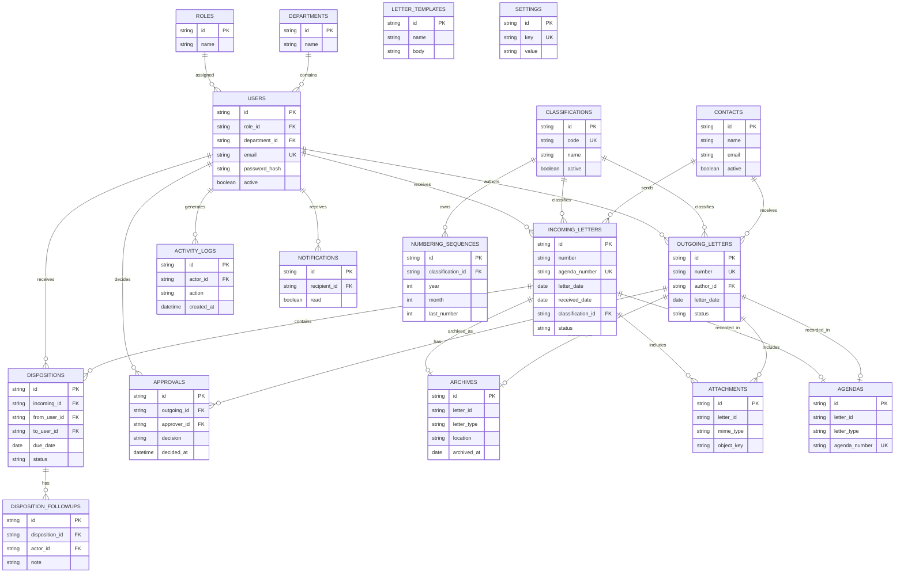

# ERD Logis — SISMARA

Dokumen ini merupakan rancangan basis data **untuk pengembangan backend di kemudian hari**. Prototipe yang diserahkan menyimpan semua data dalam satu objek JSON di LocalStorage; tabel SQL berikut *belum* digunakan di runtime.

## Integritas dan indeks yang disarankan

- Buat indeks unik untuk `users.email`, `classifications.code`, nomor agenda, dan nomor surat resmi (hanya jika sudah ditetapkan).
- Gunakan *foreign key* pada relasi surat → disposisi → tindak lanjut, dan surat keluar → persetujuan.
- Gunakan *soft delete* atau pembatalan untuk dokumen yang pernah masuk alur kerja; jangan menghapus riwayat.
- Untuk `ARCHIVES`, gunakan pasangan unik (`letter_type`, `letter_id`).
- `NUMBERING_SEQUENCES` memerlukan indeks unik (`type`, `classification_id`, `year`, `month`) serta transaksi database saat nomor resmi ditetapkan.
- Kolom password harus berupa hash aman di server jika kelak ditingkatkan menjadi aplikasi produksi, bukan password teks seperti dalam prototipe.
- Untuk penyimpanan file produksi, simpan metadata ke database, file ke storage dengan kontrol akses, serta audit trail sisi server.

## Catatan perbedaan prototipe

Dalam prototipe, buku agenda dihitung langsung dari koleksi surat, lampiran berukuran kecil disimpan sebagai data URL pada surat, dan `departments` serta `roles` berupa kumpulan referensi. Desain ERD menggambarkan normalisasi yang direkomendasikan, bukan implementasi SQL aktif.
