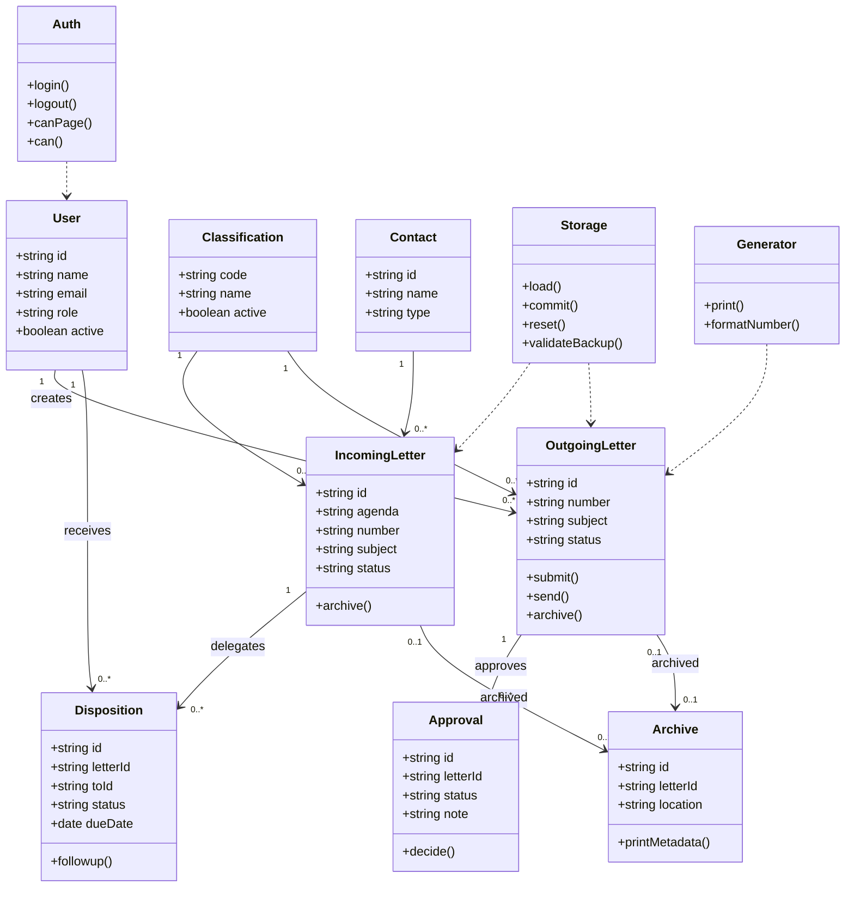

# Class Diagram Logis

Implementasi runtime terdiri dari modul JavaScript klasik dalam satu namespace global `window.SISMARA` agar dapat dimuat dengan `<script defer>` dari berkas lokal tanpa bundler atau modul ES yang dapat terkena pembatasan `file://`.
