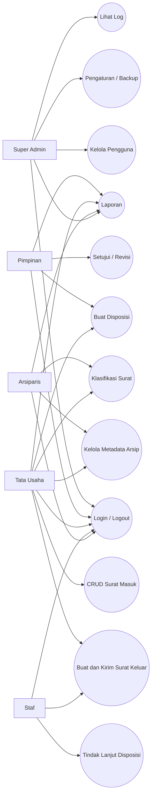

# Use Case — SISMARA

Aktor: Super Admin, Pimpinan, Tata Usaha, Staf, Arsiparis.

## Matriks akses singkat

| Modul | Admin | Pimpinan | Tata Usaha | Staf | Arsiparis |
|---|---|---|---|---|---|
| Dashboard & profil | Ya | Ya | Ya | Ya | Ya |
| Surat masuk | Penuh | Baca | CRUD | Terbatas | Baca non-rahasia |
| Surat keluar | Penuh | Baca/tinjau | Buat/kirim | Draft sendiri | — |
| Persetujuan | Penuh | Putuskan | — | — | — |
| Disposisi | Penuh | Buat | Buat | Milik sendiri | — |
| Arsip | Penuh | Baca | Kelola | — | Kelola |
| Pengguna / settings | Penuh | — | — | — | — |

Matriks ini menggambarkan **pembatasan antarmuka simulasi**, bukan kontrol akses yang aman di server.
